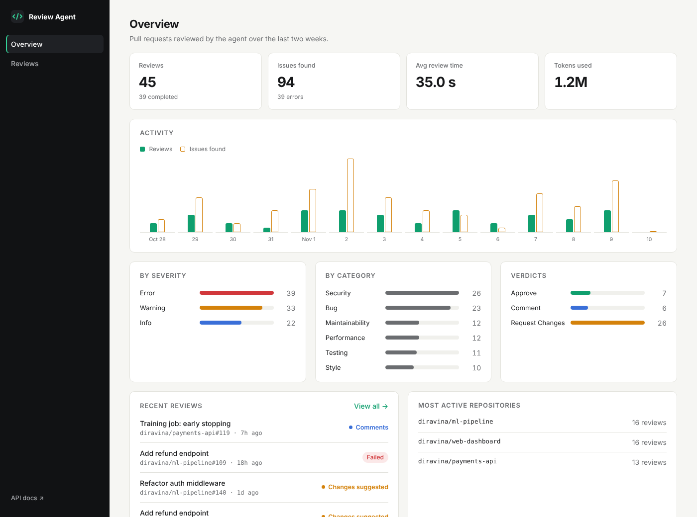
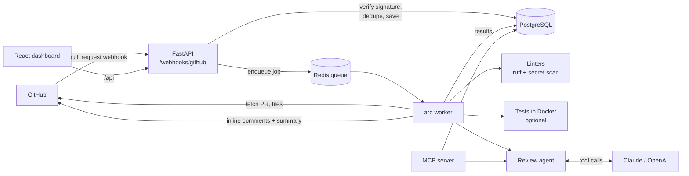

# AI Code Review Agent

A GitHub App that reviews pull requests automatically. When a PR is opened or updated, it reads the diff, runs static analysis, and lets an LLM agent investigate the change with tools before posting **inline comments and a summary** on the PR. A dashboard tracks every review and the issues found, and the reviewer's tools are also exposed as an **MCP server**.



## Features

- **GitHub App integration.** Verifies webhook signatures (HMAC-SHA256), authenticates as an app installation (JWT → short-lived token), and posts native PR reviews with inline comments.
- **Agentic review.** The LLM works in a tool-calling loop: it lists changed files, reads full files, searches code, checks lint and test results, and finishes with a structured `submit_review` call. It works with **Claude** or **OpenAI**, plus an offline mode that needs no API key.
- **Static analysis first.** Ruff (bugs and Bandit security rules) and a language-agnostic secret scanner run on the lines the PR adds, so comments stay about the change.
- **Reliable background processing.** Webhooks return immediately; reviews run on a Redis job queue (arq) with exponential-backoff retries for transient failures, idempotent handling of redelivered webhooks, and a Redis-backed rate limiter that keeps all workers under the LLM quota.
- **GitHub API resilience.** Automatic retries on 5xx and secondary rate limits (`Retry-After` / `X-RateLimit-Reset`). It skips reviews superseded by newer commits and falls back to a summary comment if GitHub rejects inline positions.
- **Dashboard.** React + TypeScript UI with review history, filters, per-review issue breakdowns, activity charts, and one-click re-runs.
- **MCP server.** Review a local `git diff`, lint it, or query review history from Claude Desktop, Claude Code, or any MCP client.
- **Optional test execution.** Runs the PR's test suite in a resource-limited Docker container. Off by default because it executes untrusted code.

## Architecture



**Review flow.** The webhook stores a `Review` row (unique on repo + PR + commit) and enqueues a job. The worker fetches the changed files at the head commit, skips lockfiles and generated or binary files, runs the linters, and starts the agent. The agent sees each diff annotated with new-file line numbers, explores with tools, and submits comments. Comments are validated against the lines GitHub will accept; anything else moves into the summary. The review is then posted and persisted.

### Agent tools

| Tool | Purpose |
|---|---|
| `list_changed_files` | Files in the PR with status and line counts |
| `get_file_diff` | Diff of one file with line numbers |
| `read_file` | Full file at the PR head, by line range |
| `search_code` | Regex search across changed files |
| `get_lint_results` | Ruff and secret-scan findings on added lines |
| `get_test_results` | Test status and output tail |
| `submit_review` | Final summary, verdict and inline comments |

## Tech stack

**Backend:** Python 3.12, FastAPI, SQLAlchemy 2 (async), PostgreSQL, Redis + arq, httpx, PyJWT, Anthropic & OpenAI SDKs, MCP Python SDK, Ruff
**Frontend:** React 19, TypeScript, Vite, React Router
**Infra:** Docker, docker-compose, nginx, GitHub Actions

## Quick start

### Try it locally in 2 minutes (no GitHub App, no API key)

```bash
cd backend
python -m venv .venv
source .venv/bin/activate          # Windows: .venv\Scripts\activate
pip install -e ".[dev]"

python -m app.cli seed             # demo data for the dashboard
uvicorn app.main:app --reload      # API on http://localhost:8000 (docs at /docs)
```

In a second terminal:

```bash
cd frontend
npm install
npm run dev                        # dashboard on http://localhost:5173
```

Review any local change from the command line:

```bash
git diff | python -m app.cli review-diff - --root .
```

### Run the full stack with Docker

```bash
cp backend/.env.example backend/.env   # then fill it in
docker compose up --build
```

This starts PostgreSQL, Redis, the API (`:8000`), the worker, and the dashboard (`:3000`).

### Connect it to GitHub

Follow **[docs/SETUP_GITHUB_APP.md](docs/SETUP_GITHUB_APP.md)**. It covers creating the app, receiving webhooks on your laptop with smee.io, and adding an LLM key.

## Configuration

All settings come from environment variables (see [`backend/.env.example`](backend/.env.example)).

| Variable | Default | Description |
|---|---|---|
| `LLM_PROVIDER` | `fake` | `anthropic`, `openai`, or `fake` (offline heuristics) |
| `LLM_MODEL` | provider default | Override the model name |
| `ANTHROPIC_API_KEY` / `OPENAI_API_KEY` | | Key for the chosen provider |
| `LLM_REQUESTS_PER_MINUTE` | `30` | Shared rate limit across all workers |
| `GITHUB_APP_ID` | | From the GitHub App settings page |
| `GITHUB_PRIVATE_KEY_PATH` | | Path to the app's `.pem` key |
| `GITHUB_WEBHOOK_SECRET` | | Must match the app's webhook secret |
| `MAX_FILES_PER_REVIEW` | `30` | Larger PRs are truncated |
| `MAX_COMMENTS_PER_REVIEW` | `25` | Cap on posted comments |
| `RUN_TESTS` | `false` | Run the PR's tests in Docker (untrusted code) |

## MCP server

```bash
cd backend
python -m app.mcp_server           # stdio, for desktop clients
python -m app.mcp_server --http    # streamable HTTP on :8765
```

Tools: `review_code_diff`, `lint_code_diff`, `list_reviews`, `get_review`, `review_stats`. See [docs/MCP.md](docs/MCP.md) for client setup.

## Testing

```bash
cd backend
pytest -q                          # 33 unit/integration tests (mocked GitHub + LLM)
ruff check . && ruff format --check .
python scripts/e2e_smoke.py        # real API + worker + Redis against a mock GitHub
```

CI runs linting, the test suite, the frontend type-check and build, and both Docker builds on every push.

## Project structure

```
backend/
  app/
    api/            webhook + dashboard REST endpoints
    github/         signature check, App auth, REST client with retries
    review/         diff parsing, linters, test runner, tools, LLM providers, agent, orchestration
    worker.py       arq worker with retry policy
    mcp_server.py   MCP server
    cli.py          local diff review + demo data
  tests/            pytest suite
  scripts/          end-to-end smoke test
frontend/           React + TypeScript dashboard
docs/               setup guides
```

## Design notes

- **Why a queue?** GitHub expects a webhook response within 10 seconds, while a review can take a minute. The API only validates and enqueues; workers scale independently.
- **Idempotency.** GitHub redelivers webhooks. A unique constraint on (repo, PR, commit) plus deterministic job ids means one review per commit.
- **Comment placement.** GitHub only accepts inline comments on lines inside the diff. The agent receives line-numbered diffs, and every comment is validated before posting.
- **Provider-neutral agent.** The tool loop uses a small internal message format, so Claude and OpenAI are swappable adapters, and tests run against a scripted fake.
- **Untrusted code.** PR code is only ever executed when `RUN_TESTS=true`, inside a container with CPU, memory, process and time limits.

## Roadmap

- Per-repo config file (`.ai-review.yml`) for rules, ignored paths and severity threshold
- Learn from 👍/👎 reactions on comments to tune future reviews
- Multi-language linters (ESLint, golangci-lint)
- GitHub Check Runs alongside review comments
